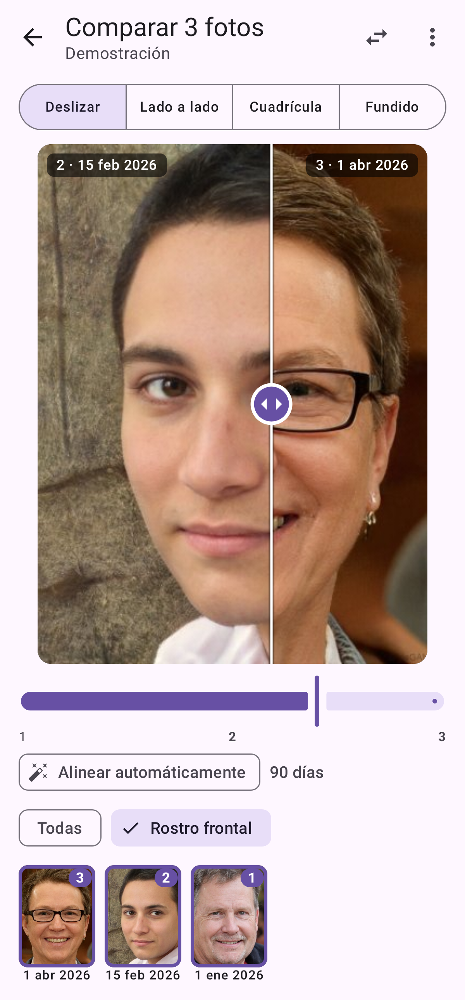
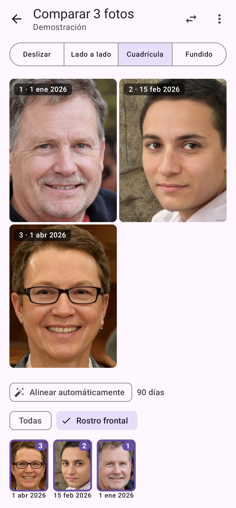
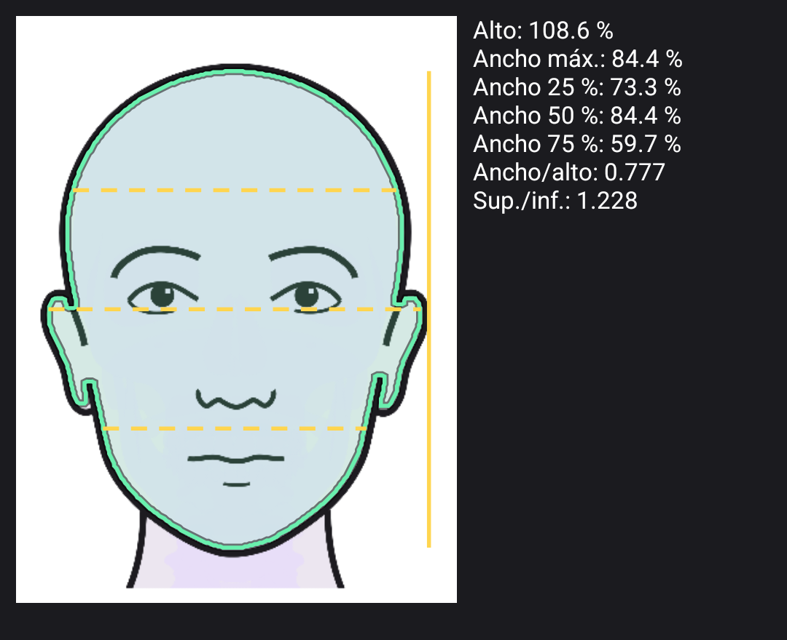
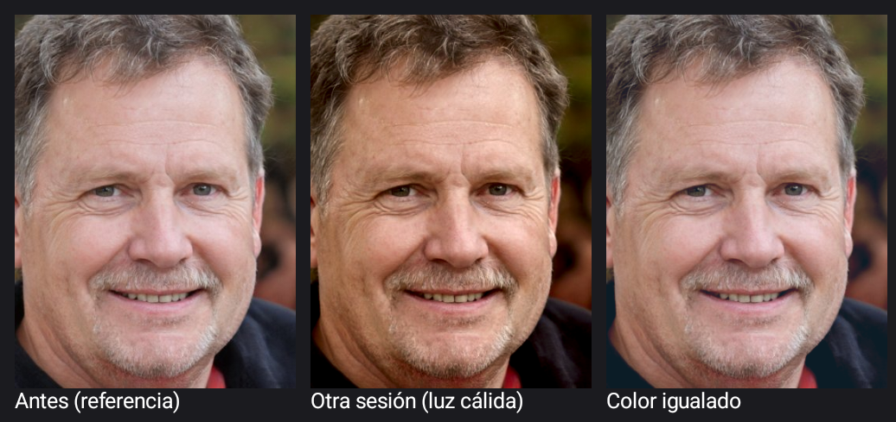
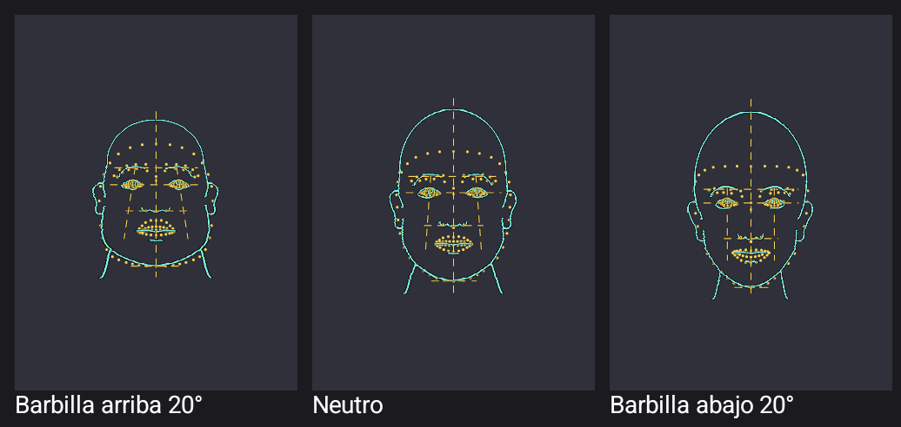
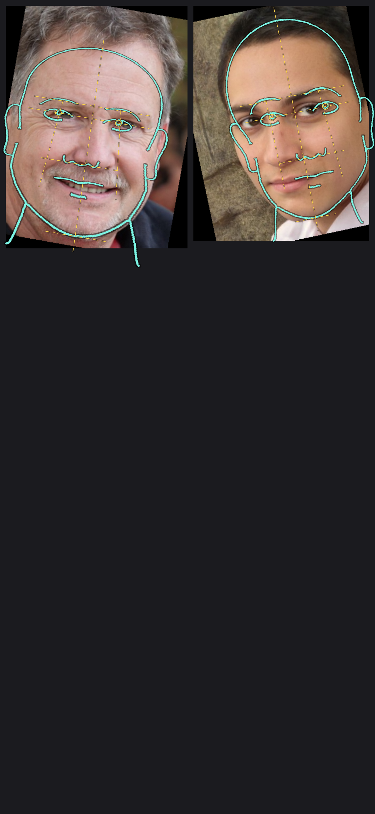

# Algoritmo de coincidencia contornal (alineación antes/después)

Objetivo: dadas dos fotografías de la **misma zona**, encontrar la transformación de semejanza
`T` (escala uniforme `s`, rotación `θ`, traslación `t`) que superpone la foto **después** sobre la
foto **antes**, para que el comparador muestre cambios reales y no diferencias de encuadre.

```
p_antes ≈ T(p_después) = s·R(θ)·p_después + t
```

Coordenadas normalizadas: `x ∈ [0,1]`, `y ∈ [0, 4/3]` (unidad = ancho de la imagen 3:4), así la
transformación es independiente de la resolución. En pantalla se aplica con
`graphicsLayer(transformOrigin = 0,0; scale = s; rotationZ = θ; translation = t·ancho)`.

## Condiciones de la alineación (menú ⋮ con casillas)

El botón principal **“Alinear automáticamente”** usa todas las condiciones activas; cada una se
puede desactivar en el menú ⋮ de Comparar o en Ajustes (se recuerdan):

| Condición | Qué hace | Si se desactiva |
|---|---|---|
| **Puntos anatómicos** | semejanza por puntos (Umeyama) y perspectiva por sus proporciones | se alinea solo por contornos |
| **Contornos** | afinado por bordes anatómicos y perspectiva por la silueta | se usa solo la transformación por puntos (los contornos solo puntúan) |
| **Mirada (gaze)** | compara la posición del iris dentro del ojo en ambas fotos y avisa si difiere | no se evalúa |

La mirada no se “corrige” con una transformación: es una condición de captura. En la cámara, con
“Exigir la misma mirada” activo, la coincidencia pasa a “cerca” mientras la mirada difiera
(MediaPipe: iris del modelo; ML Kit: centroide oscuro dentro del contorno del ojo, percentil 40 de
luminancia). Tolerancia: 0,15 del semiancho del ojo en horizontal y 0,22 del semialto en vertical
(mediana |x| en LFW frontal: 0,08).

## N fotografías

Con más de dos fotos (hasta 12) cada una se alinea a la **primera** (referencia) y:

- **Deslizar / Fundido**: una línea de tiempo recorre las transiciones 1→2→…→N; el divisor
  (o la opacidad) avanza dentro de la transición activa.
- **Lado a lado**: todas en fila (desplazable con más de 3).
- **Cuadrícula**: el número de columnas que maximiza el tamaño de celda 3:4 en la pantalla.

 

## Etapas

### 0. Perspectiva vertical por proporciones de contornos (sin sensores)

Una diferencia de inclinación de la cámara entre tomas (keystone) hace que el ancho de cada franja
horizontal cambie en proporción a su altura: p. ej. la frente se ensancha respecto de la mandíbula.
**No se usa el giroscopio**: la inclinación φ se estima de la geometría de los contornos
(`KeystoneFit`) y se corrige re-proyectando la foto “después” como con una cámara nivelada
(homografía H = K·R_x(φ)·K⁻¹ + recorte 3:4):

1. **Puntos de contorno** (hasta 133 del contorno facial, o los puntos corporales): para cada φ
   candidato se transforman los puntos de “después”, se ajusta la semejanza a “antes” y se mide el
   residuo; búsqueda en rejilla (±15°, paso 1°) + sección áurea. Solo se acepta si reduce el residuo
   ≥ 10 % (evita sobreajuste).
2. **Proporciones de la silueta** (cuando no hay puntos suficientes): con el contorno del óvalo
   facial o de la silueta del sujeto (ver “Medición de contornos”), el perfil de anchos del polígono
   a 61 alturas, normalizado por su altura (invariante a escala y posición), se calcula de forma
   exacta por intersección con las aristas; se busca el φ que iguala el perfil de “después” con el de
   “antes”. Se acepta si reduce el error ≥ 20 %.

En el comparador: menú ⋮ → “Perspectiva y ajustes” (automática o ajuste manual ±15°); el resultado de
la alineación indica el valor estimado y su origen. La inclinación del sensor se sigue guardando en
el XMP solo como dato informativo.

### Medición de contornos (varita mágica / selección automática)

Menú ⋮ → “Contornos (configuración)”. Esta pantalla **no modifica la comparación**: los contornos
elegidos (automáticos o con varita) quedan como configuración de la alineación automática, que los
usa para estimar la perspectiva por proporciones en lugar de los detectados.

- **Automática** (como al crear stickers): óvalo facial de ML Kit rasterizado, o silueta de la
  persona con ML Kit Selfie Segmentation (modelo incluido, en el dispositivo).
- **Varita mágica**: toque sobre la región; crecimiento desde la semilla con similitud de color en
  CIELAB (ΔE ≤ tolerancia respecto de la media de la región, que se adapta a degradados) y parada en
  bordes fuertes; después apertura/cierre, relleno de huecos y mayor componente conexo.
- **Métricas** (normalizadas por el ancho de la imagen): alto, ancho máximo, anchos al 25/50/75 % de
  la altura (frente, pómulos, mandíbula en el rostro), área, proporción ancho/alto, proporción
  superior/inferior y trazado del contorno; tabla antes/después con Δ % y perspectiva estimada por
  proporciones (informativa).



### 1. Puntos anatómicos según la zona (automático, en el dispositivo)

`LandmarkDetector` (ML Kit, modelos incluidos) entrega hasta **140 puntos faciales** (7 puntos +
133 de contorno: óvalo —frente, mejillas, mandíbula—, cejas, ojos, labios y nariz) o **33 puntos
corporales** (hombros, codos, muñecas, dedos índice/meñique/pulgar, caderas, rodillas, tobillos,
talones, dedos de los pies). `ZoneAlignment.of(zone)` elige el subconjunto de cada zona
(p. ej. periocular: contornos de ojos y cejas; labios: bermellón y base nasal; frente: cejas y
óvalo superior; manos: muñecas y dedos; pies: tobillos, talones y dedos).

### 2. Estimación robusta de la semejanza

Mínimos cuadrados de Umeyama en forma cerrada (ver más abajo) con **rechazo iterativo de atípicos**:
mientras queden ≥ 4 puntos se descarta el par con residuo > 9 × la mediana, hasta un 25 % de los puntos.

### 3. Coincidencia por contornos anatómicos

`EdgeAligner` compara **la orientación de los contornos** (campo de gradiente en “ángulo doble”
(gx² − gy², 2·gx·gy)/|g|), que es invariante a la polaridad del borde: funciona igual con fondo claro
u oscuro y tolera cambios de iluminación. La puntuación es una correlación ponderada

```
Σ w·⟨b(p), R(2θ)·a(T⁻¹p)⟩ / √(Σ w|b|² · Σ w|a|²)
```

donde los pesos `w` vienen de **regiones anatómicas por zona** (gaussianas en el encuadre 3:4):

| Zona | Regiones de contorno |
|---|---|
| Rostro frontal | mandíbula, frente, orejas, ojos y cejas |
| Oblicuos 45° | mandíbula, frente, oreja, mejilla y nariz |
| Perfiles | frente, nariz y labios, mandíbula, oreja, occipucio |
| Frente / periocular / labios | cejas y frente / ojos y cejas / labios, base nasal y mentón |
| Cuello | mandíbula, hombros y clavículas |
| Abdomen, tórax, espalda | cintura, caderas, ombligo / contorno mamario, hombros / escápulas, cintura |
| Abdomen lateral | silueta abdominal, glúteo, axila |
| Glúteos, muslos, brazos | pliegues glúteos, caderas / rodillas, muslos / codo, brazo |
| Manos, pies | falanges, dorso o palma / falanges, tobillos y talones |

El resultado informa la coincidencia de cada región (p. ej. “mandíbula 92 % · frente 88 %”).
Optimización: búsqueda exhaustiva gruesa (desplazamiento ±18 %, escala ±16 %, rotación ±12°) cuando
no hay puntos, o ventana estrecha alrededor de la estimación anatómica; descenso por coordenadas de
grueso a fino escalando alrededor del centroide de las regiones.

### 5. Coincidencia en vivo en la cámara

Con una foto de referencia superpuesta y la capa **Coincidir** activa, `LiveMatcher` analiza ~5
cuadros por segundo (ImageAnalysis en el mismo encuadre 3:4). La decisión (`LiveDecision`) exige:

1. **% de puntos coincidentes ≥ umbral** (configurable, **80 % por defecto**): un punto coincide si
   está a ≤ **3 %** del ancho de su posición en la referencia;
2. **geometría**: desplazamiento del pivote anatómico ≤ 3 %, escala ≤ 4 %, giro ≤ 3°;
3. **pose de la cabeza** (rostro): |Δ guiñada| y |Δ cabeceo| ≤ 6° (ángulos de Euler de ML Kit);
4. **paciente presente**: si la zona usa detector y la referencia tiene puntos, un cuadro sin
   puntos **nunca** coincide (antes, apuntar al piso podía coincidir por bordes).

Zonas o referencias sin puntos anatómicos: `ContourMatch` compara los 300 bordes más fuertes de la
referencia (en las regiones anatómicas) exigiendo **misma orientación** (±20°) y descuenta el azar
(tasa de aciertos con los puntos desplazados lejos), que es alta en superficies muy texturizadas.

#### Evaluación con imágenes reales (`FaceMatchingRealImagesTest`, `tools/eval`)

Rostros reales de LFW (Labeled Faces in the Wild; puntos con MediaPipe agrupados como ML Kit),
40 fotos de stock aleatorias (Unsplash) y 12 texturas/escenas reales (piso, ladrillo, césped, grava…):

| Caso | Solo % de puntos | Regla final |
|---|---|---|
| Retoma (temblor ≤ 1 %, escala ≤ 1,5 %, ≤ 1°, brillo y ruido; detección repetida) | 100 % | **100 %** coincide |
| Desalineación moderada (3,5 % / 5 % / 3°) | 48 % | 8 % (límite) |
| Desalineación grande (8 % / 12 % / 6°) | 18 % ✗ | **0 %** |
| Otra persona con el mismo encuadre | 1,8 % | **0,5 %** |
| Sin paciente (piso, texturas, escenas) | — | **0 %** (sin rostro) |
| Contornos: retoma / desplazamiento 8 % / sin paciente | — | 39/40 · 0/40 · **0/2080** |

Distinguir *identidades* por la geometría no es fiable (las distancias de forma de la misma persona y
de personas distintas se solapan: varían más con la pose y la expresión); y en estética médica la
forma cambia con el tratamiento. La identidad la garantiza el expediente; la coincidencia mide el
**encuadre**.

#### Motores de puntos faciales intercambiables

Ajustes → “Motor de puntos faciales”: **Google ML Kit** (133 puntos de contorno + 7 puntos, ángulos de
Euler) o **MediaPipe Face Landmarker** (478 puntos 3D + matriz de pose; Apache 2.0, modelo incluido).
`FaceMeshMap` agrupa la malla de MediaPipe con las mismas claves que ML Kit (óvalo, cejas, ojos,
labios, nariz, pupilas por el iris), de modo que alineación, coincidencia, perspectiva, guía adaptada
y estandarización funcionan igual con ambos. Referencia y cuadro actual usan siempre el mismo motor
(al cambiarlo se recalcula la referencia). La evaluación con LFW (`tools/eval`) se hizo con esta misma
agrupación de MediaPipe.

#### Estandarización sin foto de referencia (primera toma de una zona)

`Standardization` aplica los estándares de fotografía clínica: vista (giro de la cabeza 0° frontal,
45° oblicuo hacia el lado de la zona, ≥ 70° perfil), plano de Frankfort (cabeceo ≤ 7°), cabeza recta
(alabeo ≤ 4°), iluminación uniforme (mejillas ±15 %) y exposición (L* del rostro 35–85). El sentido del
giro se obtiene de la geometría (punta nasal frente al óvalo), común a ambos motores: concuerda con la
pose 3D en el **100 %** de 227 rostros reales girados ≥ 10° (LFW).

#### Asistencia al operador

- Indicaciones **fuera de la imagen** (franja bajo la vista previa) y **flechas en el borde** hacia
  donde mover el teléfono, calculadas en coordenadas de pantalla según cámara y espejo.
- El **giro** necesario se dibuja en el nivel (línea objetivo discontinua + ángulo).
- **Zoom asistido** (`ZoomController`): filtro del error de escala, zona muerta ±2 %, 3 cuadros de
  tendencia, paso ≤ 12 %, amortiguación al sobrepasar y **espera a que el zoom se aplique y la cámara
  reenfoque** (en el pivote anatómico) antes de volver a medir; probado con una planta simulada con
  retraso y ruido (converge sin oscilar). El disparo automático también enfoca y espera; con la distancia estimada (interpupilar ≈ 6,3 cm) se recomienda trabajar a
  ≥ 1 m para evitar el “efecto selfie”.
- **Disparo automático** tras ~0,4 s de coincidencia (o de encuadre estándar), sin zoom en curso,
  tras enfocar en el pivote anatómico; una vez por coincidencia.
- **Condiciones de captura** en el XMP (`pm:Cond_*`: motor, asistencia, % de puntos, giro de la
  cabeza, distancia estimada, zoom); el comparador avisa si un par no es comparable.

## Resultado

El comparador muestra el método usado, la escala y la rotación aplicadas y un interruptor para ver
la foto original o la alineada en los tres modos (deslizador, lado a lado, fundido).

## Verificación

`app/src/test/java/com/photomed/app/AlignmentTest.kt`:

- semejanza exacta con 2 puntos, inversa y composición;
- rechazo de un punto anatómico erróneo;
- recuperación de una transformación conocida (escala 1,08, rotación 4°, desplazamiento 7 %) **solo
  por contornos**, con error < 1,2 % del ancho;
- afinado de una estimación anatómica ruidosa: el error se reduce a menos de un tercio y < 1 %;
- coincidencia guiada por regiones anatómicas con puntuación por región;
- rechazo de varios puntos erróneos entre 36 del óvalo facial.

`PerspectiveAndLiveTest.kt`: la corrección nivela exactamente una cámara inclinada sintética
(−12° y +8°) y deja verticales las verticales del mundo; estados e indicaciones de la coincidencia en
vivo, incluida la histéresis.

`KeystoneAndWandTest.kt`: la perspectiva se recupera desde puntos del contorno facial (±0,3°) y
desde las proporciones de la silueta con otra escala y encuadre (±1°); sin inclinación no se inventa
corrección; la varita mágica selecciona una región de piel con degradado y ruido (área ±6 %) y mide
alto y anchos (±3 %). `PerspectiveAndLiveTest.kt`: umbral de puntos (99 %, 98 %, histéresis) e
indicaciones de inclinación.

**Pendiente de verificar en un teléfono real:** rendimiento del análisis en vivo y de la
segmentación, y ajuste fino de la tolerancia por punto (1,5 %) con fotos reales.

Limitaciones: la corrección de perspectiva cubre la inclinación vertical, no la distancia ni giros laterales de la cámara;
ni cambios de postura no rígidos (por ejemplo, un brazo en otra posición). Las guías de la cámara,
el nivel y la superposición de la foto anterior reducen estas diferencias en el momento de la toma.

### Igualación del color de la piel

Menú ⋮ → “Igualar color de piel” (Reinhard et al., 2001): estadísticos de la piel en CIELAB (región
automática —óvalo facial reducido o silueta— o un punto de referencia tocado en cada foto) y ajuste
de “después”: gamma (tonos medios), contraste y brillo (L*), temperatura (b*) y tinte (a*). En la
prueba con una foto real distorsionada (más oscura, más contraste, luz cálida) la piel pasa de
ΔE 10,8 a **ΔE 0,4**.




## Guía adaptada a la foto de referencia

**Rostro (frontal, tercio superior, periocular, labios): rasgo a rasgo.** Thin-plate spline
(Bookstein, 1989) con ~140 puntos de control: los de la malla de MediaPipe detectada sobre el propio
dibujo (`tools/guides/face_controls.py`) se llevan a los mismos puntos de la foto: ojos (posición,
amplitud y altura), cejas, nariz, boca (línea media de los labios, para que la boca abierta no
ensanche el trazo), óvalo (frente, sienes, mejillas, mandíbula, mentón). Orejas (borde superior,
hélice, lóbulo) y vértice del cráneo se proyectan desde el modelo 3D con la pose de la cabeza, así
siguen giro, inclinación y cabeceo. La ilustración se dibuja como malla deformada (36×48 celdas).
Sin puntos suficientes se usa el ajuste por franjas descrito abajo.

**Oblicuos 45°:** la misma deformación rasgo a rasgo. Sus puntos de control salen de proyectar los
del frontal con la misma superficie de cabeza girada que sintetizó el dibujo
(`tools/guides/synth_oblique.py`); el izquierdo es el reflejo del derecho (claves simétricas de la
malla canónica, `art/source/face_key_mirror.json`). Oreja cercana marcada en el dibujo.

**Perfiles y cuerpo: silueta.** Al fijar la referencia se segmenta el sujeto (ML Kit Selfie
Segmentation) y se mide, por filas, el tramo que contiene el eje (pose u ojos). El dibujo tiene el
mismo contorno por filas (`build_guides.py`) y cada franja se escala a cada lado hasta los bordes de
la silueta: hombros, cintura, caderas, cuello, espalda, glúteos, brazos; nuca y borde facial en el
perfil. Anclas verticales: pose (hombros, codos, caderas, rodillas) en el cuerpo; en el perfil,
punta nasal y pogonion de la silueta (máxima protrusión del borde anterior y tras el surco
mentolabial, mismo algoritmo en el dibujo y en la foto) y la parte alta de la cabeza. Inclinación:
línea de hombros. Manos y pies: sin detector ni silueta fiable (la segmentación es de personas),
mantienen la guía estándar.

1. **Inclinación**: ángulo de la línea entre los centros de los contornos de los ojos (o pupilas;
   hombros en el cuerpo). Los puntos se enderezan antes de ajustar y la guía se dibuja girada ese
   ángulo. La misma medida se usa en la estandarización ("Enderece la cabeza: inclinada N° hacia…"),
   más estable que el ángulo de Euler del modo rápido de ML Kit.
2. **Vertical**: anclas (cejas, pupilas, base nasal, boca, mentón) a su altura detectada.
3. **Cabeceo (barbilla arriba/abajo)**: pose 3D de la cabeza por ajuste de los puntos al modelo
   canónico del rostro de MediaPipe (`HeadPose`, perspectiva débil, mínimos cuadrados). El vértice del
   cráneo se proyecta con esa pose y se usa como ancla: con la barbilla arriba el cráneo se acorta en
   la imagen; con la barbilla abajo se alarga. Validado con 536 rostros de LFW frente a la pose de
   MediaPipe (r = 0,958; error medio 1,96°). La misma pose se usa en la cámara: el cabeceo relativo
   a la referencia ("Suba/Baje la barbilla N°"), el plano de Frankfort sin referencia (con ML Kit se
   promedia con su ángulo de Euler) y se guarda en la foto (`HeadPitch`); Comparar avisa si el
   cabeceo de dos fotos difiere más de 6°. Corregido: el cabeceo de MediaPipe tenía el signo opuesto
   al de ML Kit.
4. **Contorno de la cabeza** (`tools/guides/face_profile.py`): bordes izquierdo/derecho del cráneo,
   sienes, mejillas, mandíbula y mentón de la ilustración, por filas. En la app cada franja de la
   guía se escala por separado a cada lado de la línea media hasta el óvalo facial detectado a esa
   altura (desde las cejas; el cráneo conserva la forma de la ilustración con el ancho de la frente).




