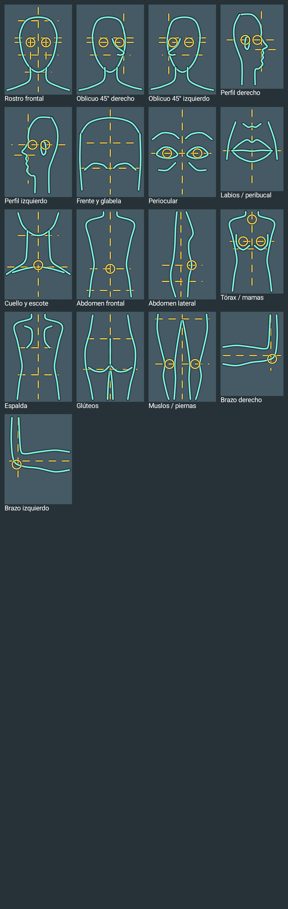

# Contornos anatómicos de referencia

Los 17 contornos de la cámara (`app/src/main/java/com/photomed/app/ui/camera/GuideOverlay.kt`) son
**dibujos propios** de este proyecto, publicados bajo la licencia MIT del repositorio. Se definen
como puntos normalizados en un encuadre 3:4 y se trazan con curvas Catmull-Rom; las líneas
discontinuas son referencias anatómicas y los círculos son puntos de referencia.

## Referencias libres consultadas

Se buscaron siluetas de dominio público **sin requisito de atribución** como inspiración para las
proporciones generales:

| Referencia | Licencia (según la página) | Uso |
|---|---|---|
| [Female head profile silhouette — FreeSVG #71117](https://freesvg.org/females-head-profile-silhouette) (publicado por OpenClipart) | Public Domain (CC0), “No attribution required” | Proporción del perfil facial |
| [Male body silhouette — FreeSVG #7918](https://freesvg.org/male-body-silhouette-vector-clip-art) (OpenClipart) | Public Domain (CC0), “No attribution required” | Proporción del tronco y miembros |
| [Silhouette of man standing and facing forward — Wikimedia Commons](https://commons.wikimedia.org/wiki/File:Silhouette_of_man_standing_and_facing_forward.svg) | CC0 1.0 (según la búsqueda; verificar en la página antes de reutilizar el archivo) | Proporción corporal frontal |

**Por qué no se incorporaron sus trazados:** son siluetas rellenas de carácter artístico (cabello,
ropa, pose), sin puntos anatómicos ni líneas clínicas, y su escala no corresponde a los encuadres
estandarizados de fotografía clínica. Se usaron solo como referencia visual de proporciones; ningún
trazado de terceros forma parte del código.

## Criterios anatómicos usados

- **Rostro frontal:** cánones neoclásicos de proporción facial — tercios faciales iguales (implantación
  capilar – glabela – subnasal – mentón), línea pupilar, líneas medio-pupilares y línea media.
- **Perfiles:** plano horizontal de Frankfort (tragion – orbitale) y vertical verdadera por glabela,
  según los estándares habituales de fotografía clínica en cirugía plástica y estética.
- **Oblicuo 45°:** punta nasal alineada con el contorno de la mejilla.
- **Corporal:** línea media, ombligo, pliegue inframamario, pliegue glúteo y rodillas como
  referencias de reposicionamiento, con encuadres de cuerpo estandarizados.
